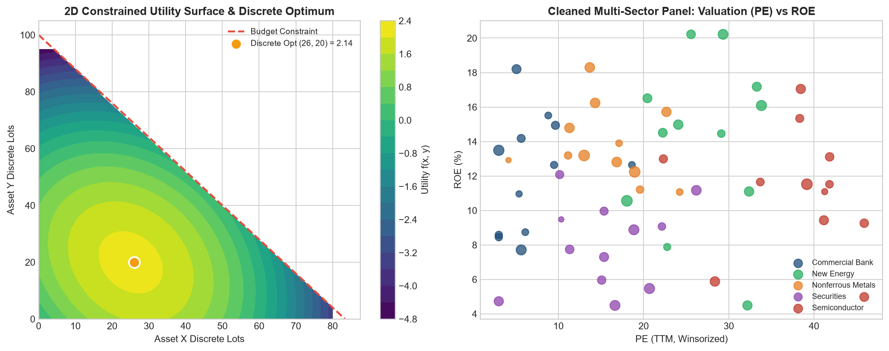

# 多变量数值计算引擎与 Python/LLM 自动化可视化工作流

> **Multivariable Numerical Optimization Engine & Automated AI Data Workflow**  
> 集 **HTML/JS 二维空间离散最优解交互模拟器**、**Python 数据清洗与可视化自动化管线** 以及 **DeepSeek / Gemini API 结构化金融信息抽取工作流** 于一体的轻量级工具集。


---

## 一、核心模块设计

### 1. 前端交互式多变量数值计算器与二维最优解模拟器（`web/`）
- **零后端依赖**：直接打开 [web/index.html](web/index.html) 即可运行（亦支持一键部署 GitHub Pages）。
- **多情景约束求解**：内置三类金融与运筹优化模型：
  1. 金融资产离散仓位效用最大化（均值-方差-交易成本 + 预算约束 $c_1 x + c_2 y \le B$）
  2. 复杂离散条件下多要素产出与边际利润最优化（含离散档位跃迁与失衡惩罚）
  3. 量化网格交易参数二维寻优（网格间距 $\times$ 单格仓位）
- **交互能力**：支持 6 维度参数滑块实时动态调参、Canvas 二维响应曲面热力图渲染、可行域边界高亮、Top-5 离散最优组合排行、局部数值梯度 $(\partial f/\partial x, \partial f/\partial y)$ 计算与鼠标实时探测。

### 2. Python 数据清洗自动化与可视化脚本（`python_workflow/data_cleaner.py`）
- 面向异构金融面板数据的自动质检与清洗流水线：主键去重 → 行业中位数缺失值插补 → `[2%, 98%]` 缩尾（Winsorization）抑制极端财务异常值 → 标准化复合质量打分 → 自动输出诊断图表。

### 3. 大语言模型 API 结构化抽取工作流（`python_workflow/llm_pipeline.py`）
- 原生封装 **DeepSeek API**（OpenAI 兼容接口）与 **Gemini API**（REST `responseMimeType: application/json`），无重型 SDK 依赖。
- 将非结构化券商研报、银行季报快讯与企业公告批量转化为严格 JSON Schema 结构化指标，并自动编译为 Markdown 投研摘要（[outputs/automated_briefing.md](outputs/automated_briefing.md)）。
- 当本地未配置环境变量 `DEEPSEEK_API_KEY` / `GEMINI_API_KEY` 时，自动切换为确定性离线结构化解析模式，保证全流程 100% 可复现。

---

## 二、可视化输出示例



---

## 三、目录结构

```text
multivar-opt-ai-workflow/
├── web/
│   ├── index.html                  # 网页端数值计算器与二维空间最优解模拟器
│   ├── styles.css                  # 深色金融科技风格响应式样式
│   └── optimizer.js                # 离散约束极值求解与 Canvas 热力图引擎
├── python_workflow/
│   ├── data_cleaner.py             # 金融面板自动去重/插补/缩尾与可视化
│   ├── llm_pipeline.py             # DeepSeek / Gemini API 统一结构化抽取客户端
│   └── run_pipeline.py             # 端到端自动化工作流入口
├── data/                           # 示例原始脏数据与非结构化公告样本
├── outputs/                        # 清洗后 CSV、LLM 结构化 JSON 与自动简报
└── assets/                         # 自动生成的响应曲面与行业散点图
```

---

## 四、快速启动

### 1. 运行网页端二维最优解模拟器
直接在浏览器中打开 `web/index.html` 即可交互使用（或使用任意静态服务器如 `python -m http.server -d web 8000`）。

### 2. 运行 Python 数据清洗 + LLM 自动化工作流
```bash
pip install -r requirements.txt

# 方式 A：离线可复现演示模式（无需 API Key）
python -m python_workflow.run_pipeline

# 方式 B：接入真实 DeepSeek 或 Gemini API
# export DEEPSEEK_API_KEY="your_deepseek_key"
# export GEMINI_API_KEY="your_gemini_key"
# python -m python_workflow.run_pipeline
```
